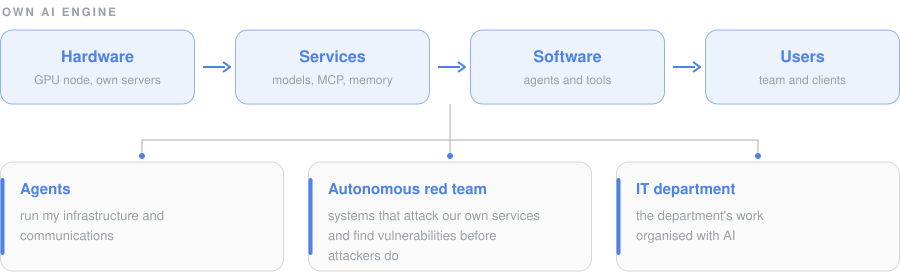
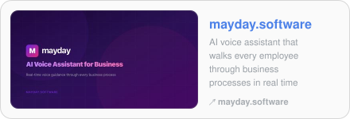
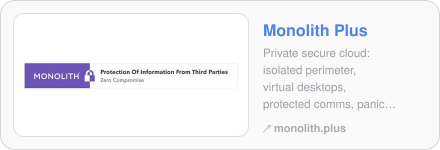
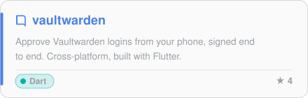
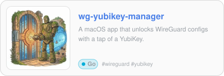
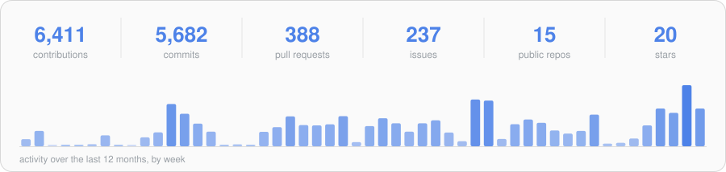

<b>English</b> · <a href="README.ru.md">Русский</a>

<b>Fractional CTO · infrastructure, security, AI agents and voice systems</b>

<a href="#what">What I do</a> · <a href="#stack">Tech stack</a> · <a href="#writing">Writing</a> · <a href="#products">Products</a> · <a href="#open-source">Open source</a> · <a href="#stats">Stats</a>

### What I do

- **Infrastructure as code from bare metal up**: Proxmox and ESXi fleets, Ansible tested in CI (Molecule idempotence runs, strict linting, secret checks, multi-arch images, TPM 2.0 attestation), changes predicted before they run.
- **Security that does not depend on one person**: secrets in OpenBao and SOPS behind hardware keys, mTLS, Zero Trust access, self-hosted MDM and SIEM.
- **AI agents and AI security**: self-hosted Claude agents with MCP servers, long-term memory and a GPU node; an autonomous AI red team; the boundary lives in code, not in the prompt.
- **Voice systems**: Kamailio SBC clusters with RTPEngine, SIP over TLS and SRTP, bridged to Asterisk, 3CX, Kerio and GSM gateways, with Homer SIP capture.
- **Crypto custody and hardware keys**: multisig across hardware wallets, Shamir-split recovery on YubiKeys, TON contracts and on-chain timestamping.
- **Forensics**: DFIR triage of Windows hosts from registry, NTFS and memory artifacts.
- **Hardware and radio**: ESP32 firmware, Zigbee and LoRa nodes, an EMQX broker, NFC and Apple Home Key, SDR and DMR.

**💻 Languages** 

**☁️ Cloud** 

**🏗️ Infrastructure as code** 

**🧪 CI & testing** 

**🌐 Network & edge** 

**🛡️ Security & secrets** 

**🔎 Forensics & DFIR** 

**🔑 Hardware keys & smartcards** 

**🪙 Crypto & Web3** 

**📞 VoIP** 

**📨 Messaging & brokers** 

**📧 Mail & groupware** 

**📈 Observability & data** 

**📱 Apps & web** 

**📡 Hardware, radio & IoT** 

**🤖 AI: what I build now** 

Badges link to my article on the topic when I have one, otherwise the project page.

### Recent writing

<!-- BLOG-POST-LIST:START -->

<!-- BLOG-POST-LIST:END -->

<a href="https://ilia.ae/blog/">All articles →</a> · updated daily from the site RSS

### Products

### My open source

<a href="https://ilia.ae/en/cases/">All projects on the site →</a>

### GitHub stats

